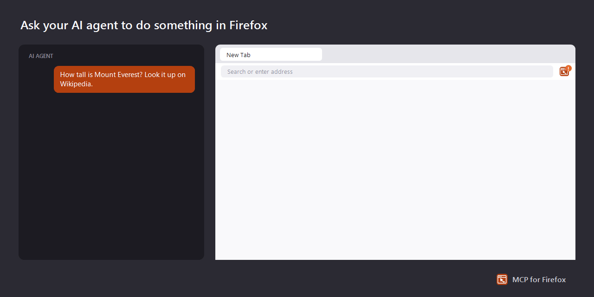

# MCP for Firefox

Lets AI agents use **your own Firefox**: the sites you're signed in to, in tabs of their own.



## Set it up

You need [Node.js](https://nodejs.org) 20 or later and Firefox 140 or later.

**1. Get the server**

```sh
git clone https://github.com/dh1011/firefox-mcp
cd firefox-mcp
npm install
npm run build
```

**2. Add the extension to Firefox**

Install [MCP for Firefox](https://addons.mozilla.org/firefox/addon/mcp-for-firefox/) from addons.mozilla.org. To run your own build instead, see [other ways to load the extension](docs/how-it-works.md#other-ways-to-load-the-extension).

**3. Add it to your AI app**

In your AI app's MCP settings, add:

```json
{
  "mcpServers": {
    "firefox": {
      "command": "node",
      "args": ["/path/to/firefox-mcp/dist/server/index.js"]
    }
  }
}
```

**4. Approve it**

The first time an agent uses the browser, the MCP for Firefox button in the toolbar shows **!**. Click it, check that the code matches the one your AI app shows, and click **Allow**. You only do this once.

## Use it

Ask your agent for something in plain words:

- "How tall is Mount Everest? Look it up on Wikipedia."
- "Open my GitHub notifications and tell me what's new."
- "Find a table for two at an Italian place near me on Saturday."

Agents work in tabs of their own, grouped under the AI app's name, and leave your other tabs alone.

## Stay in control

- Click the toolbar button and press **Stop** to halt agents at any time.
- Agents can do what you can on the sites you're signed in to, including uploading files from your computer. A page can try to trick an agent, so keep an eye on what it does on sites that matter.
- It never opens Firefox's own pages, other extensions, or Mozilla's add-on and account sites.

More detail: [how it works, and what it does and doesn't protect against](docs/how-it-works.md).

## License

[Apache-2.0](LICENSE), with third-party attributions in [NOTICE](NOTICE). Not affiliated with or endorsed by Mozilla.
